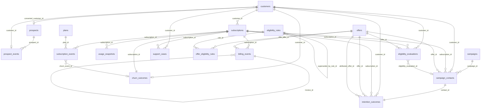

# Entity relationship diagram

## Cardinality and lifecycle notes

| Relationship | Cardinality | Optional | Note |
|---|---|---|---|
| prospects.converted_customer_id -> customers.customer_id | 1:0..1 | yes | lead that became a customer; legacy customers have none |
| prospect_events.prospect_id -> prospects.prospect_id | 1:N | no | funnel history |
| prospect_events.customer_id -> customers.customer_id | N:0..1 | yes | CONVERTED event only |
| subscriptions.customer_id -> customers.customer_id | 1:N | no | customer has 1..2 subscriptions |
| subscription_events.subscription_id -> subscriptions.subscription_id | 1:N | no | lifecycle history |
| subscription_events.plan_id -> plans.plan_id | N:1 | no |  |
| usage_snapshots.subscription_id -> subscriptions.subscription_id | 1:N | no | one per active month |
| billing_events.subscription_id -> subscriptions.subscription_id | 1:N | no |  |
| billing_events.invoice_id -> billing_events.billing_event_id | 1:N | yes | payments/credits point at their invoice |
| billing_events.offer_id -> offers.offer_id | N:1 | yes | CREDIT events carry the offer for cost tracking |
| support_cases.customer_id -> customers.customer_id | 1:N | no |  |
| support_cases.subscription_id -> subscriptions.subscription_id | N:1 | no |  |
| offer_eligibility_rules.offer_id -> offers.offer_id | N:M bridge | no |  |
| offer_eligibility_rules.rule_id -> eligibility_rules.rule_id | N:M bridge | no |  |
| eligibility_rules.superseded_by_rule_id -> eligibility_rules.rule_id | 1:0..1 | yes |  |
| eligibility_evaluations.customer_id -> customers.customer_id | 1:N | no |  |
| eligibility_evaluations.subscription_id -> subscriptions.subscription_id | 1:N | no |  |
| eligibility_evaluations.offer_id -> offers.offer_id | N:1 | no |  |
| campaign_contacts.campaign_id -> campaigns.campaign_id | N:1 | no |  |
| campaign_contacts.customer_id -> customers.customer_id | 1:N | no | 1:1 per campaign (violations = anomalies) |
| campaign_contacts.subscription_id -> subscriptions.subscription_id | 1:N | no |  |
| campaign_contacts.offer_id -> offers.offer_id | N:1 | yes | null for CONTROL |
| campaign_contacts.eligibility_evaluation_id -> eligibility_evaluations.evaluation_id | N:0..1 | yes |  |
| churn_outcomes.customer_id -> customers.customer_id | 1:0..1 | no | one label per customer per year |
| churn_outcomes.subscription_id -> subscriptions.subscription_id | 1:1 | no |  |
| churn_outcomes.churn_event_id -> subscription_events.subscription_event_id | N:0..1 | yes |  |
| retention_outcomes.contact_id -> campaign_contacts.contact_id | 1:1 | no |  |
| retention_outcomes.customer_id -> customers.customer_id | 1:N | no |  |
| retention_outcomes.subscription_id -> subscriptions.subscription_id | 1:N | no |  |
| retention_outcomes.offer_id -> offers.offer_id | N:1 | yes |  |
| retention_outcomes.attributed_offer_id -> offers.offer_id | N:1 | yes |  |

**Lifecycle states**

- Subscription: `ACTIVE -> CANCELLED | TERMINATED_NONPAYMENT` (terminal, derived from `subscription_events`; plan changes and price changes are events, never overwrites).
- Invoice: `INVOICE -> (CREDIT) -> PAYMENT | PAYMENT_FAILED x1..3 -> WRITE_OFF`; every invoice must reconcile to zero balance.
- Support case: `OPEN -> ESCALATED -> RESOLVED` with explicit timestamps.
- Offer / rule: effective-dated (`valid_from/valid_to`, `effective_from/effective_to`); superseded rules are `RETIRED`, never edited.
- Campaign contact: `HOLDOUT` (control) or `DELIVERED/BOUNCED` (treatment); a customer is in exactly one arm per campaign.
